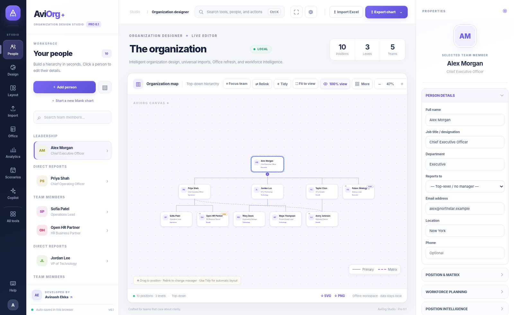
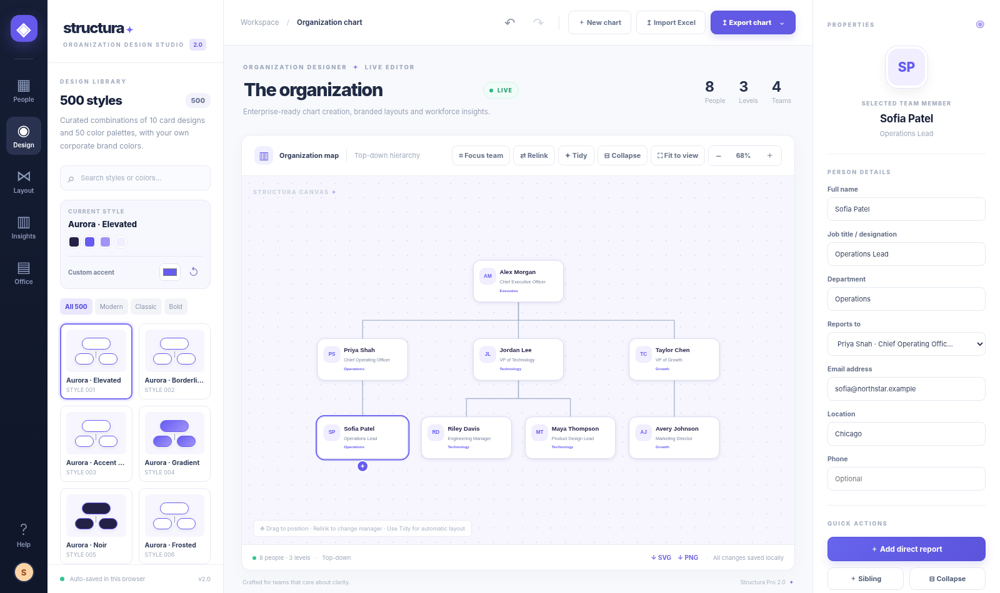
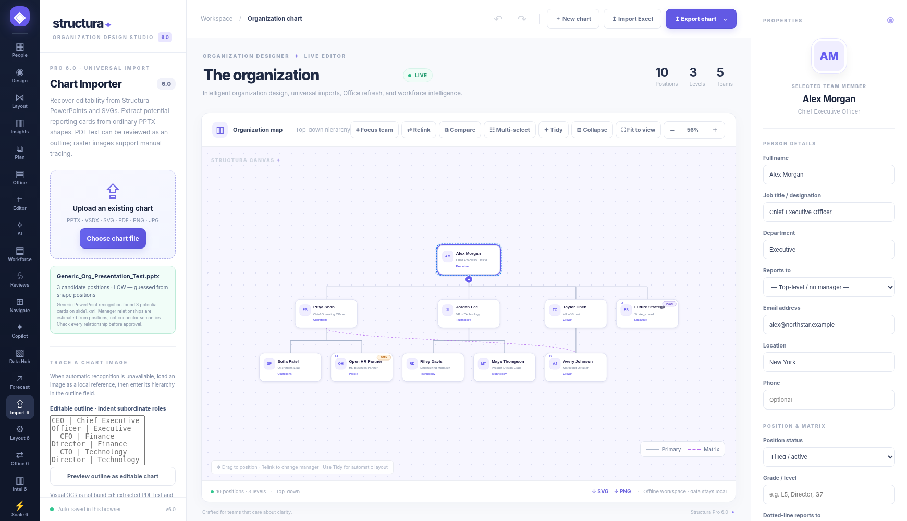
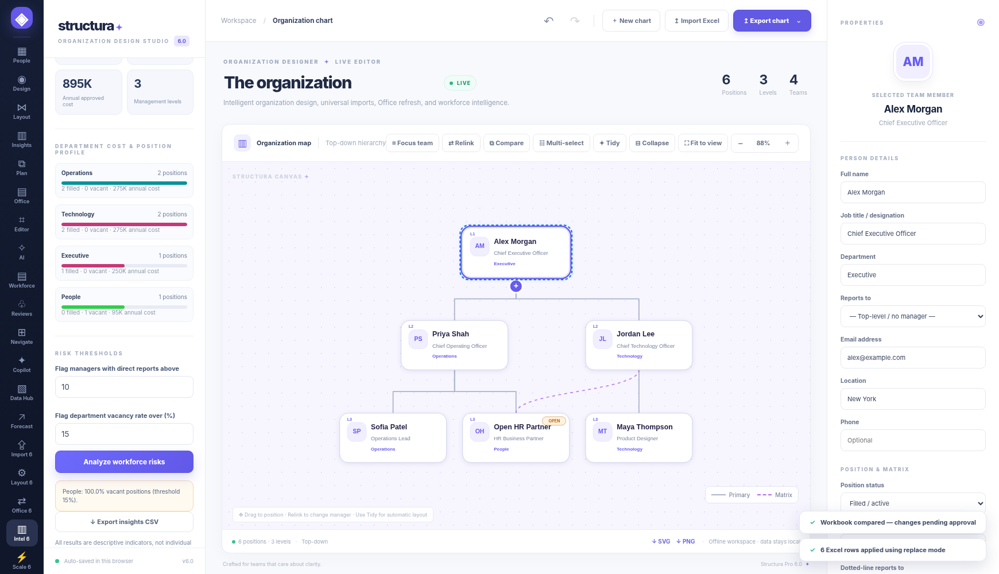
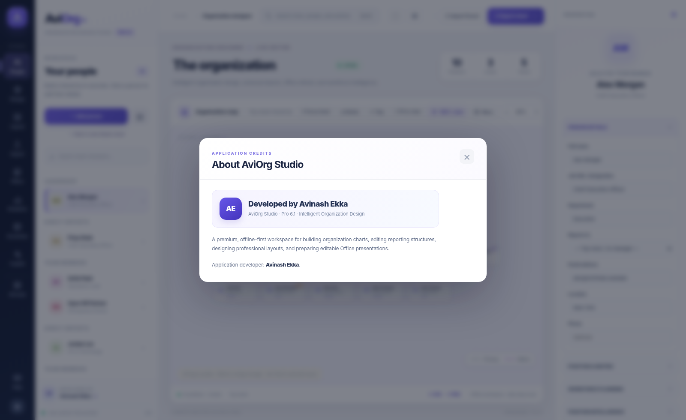

<div align="center">
  

# AviOrg Studio
### Intelligent Organization Design, Simplified

**A premium browser-based organizational chart designer**  
Create, customize, analyze, and export beautiful organization charts with a polished visual editor.

**AviOrg Pro 6.1** · **Developed by Avinash Ekka**

[Features](#features) · [Screenshots](#screenshots) · [How to Use](#how-to-use) · [Excel & PowerPoint](#excel--powerpoint)
</div>

---

## Screenshots

### Main application



### Org chart design gallery



### More app views

<table>
  <tr>
    <td align="center"><br /><sub><b>Command palette</b></sub></td>
    <td align="center"><br /><sub><b>Tool library</b></sub></td>
  </tr>
  <tr>
    <td align="center"><br /><sub><b>Universal importer</b></sub></td>
    <td align="center"><br /><sub><b>Workforce analytics</b></sub></td>
  </tr>
</table>

### About & developer credits



## Features

- **Premium chart editor** with drag-and-drop editing, zooming, focusing, alignment, spacing, and smart arrangement.
- **500 design combinations** with multiple styles, palettes, typography, connectors, and presentation-friendly layouts.
- **Bulk Excel and CSV import** with flexible column mapping, validation, and import review.
- **Editable PowerPoint export** with native shapes and text, not just a flat image.
- **PDF, PNG, SVG, XLSX, CSV, and JSON export** for sharing and reuse.
- **Matrix reporting** with primary and dotted-line relationships.
- **Scenario planning** to compare hierarchy changes and explore future structures.
- **Workforce intelligence** including headcount, vacancies, FTE, department summaries, and annual position costs.
- **Universal importer** for supported AviOrg/legacy Structura files and review-based reconstruction from selected external chart formats.
- **AI-assisted tools** for supported commands, previews, layout checks, and optional local AI workflows.
- **Searchable command palette** and streamlined navigation for faster use.
- **Offline-ready usage** through the standalone HTML edition.

## How to use

### Option 1 — Use the standalone app (recommended)

1. Download the standalone file: [`standalone/AviOrg_Studio_Pro_6_1.html`](standalone/AviOrg_Studio_Pro_6_1.html)
2. Open it in **Google Chrome** or **Microsoft Edge**.
3. Start with a sample organization or build your chart from scratch.
4. Import your employee data if needed.
5. Customize the org chart and export it in your preferred format.

### Option 2 — Use the website version locally

If you downloaded the repository, you can run it locally with a simple server:

```bash
python -m http.server 8000
```

Then open:

```text
http://localhost:8000
```

## Create your first org chart

1. **Add employee or position cards** manually, or import them from Excel.
2. **Set reporting relationships** by selecting each person's manager.
3. **Apply a design** from the style library.
4. **Adjust colors, spacing, connectors, and typography** to match your needs.
5. **Use analytics and planning tools** if you want headcount insights or scenario comparisons.
6. **Export your chart** as PowerPoint, PDF, image, or spreadsheet.

## Excel & PowerPoint

### Excel import

Use the ready-made template here:

- [Excel Import Template](examples/AviOrg_Excel_Import_Template.xlsx)

The import tools help validate managers, map columns, and review updates before applying them to your chart.

### PowerPoint export

AviOrg Studio can generate editable PowerPoint slides. You can review the sample here:

- [Editable PowerPoint Example](examples/AviOrg_Editable_Example.pptx)

## Repository contents

```text
AviOrg-Studio/
├── index.html
├── assets/
├── docs/
├── examples/
├── standalone/
├── scripts/
├── tests/
└── .github/
```

## Best for

AviOrg Studio is useful for:

- HR teams
- managers and department heads
- business consultants
- project and program teams
- nonprofit organizations
- anyone who needs clear, beautiful organizational charts

## Notes and limitations

- The standalone app works offline in the browser.
- Sensitive employee data should not be stored in a public repository.
- Some advanced enterprise capabilities—such as live Microsoft 365 sync, real-time collaboration, SSO, and hosted cloud AI—require a separate deployment beyond this static repository.
- Import reconstruction from external files may require manual review.

## Credits

**AviOrg Studio — Developed by Avinash Ekka**  
*Exploring AI and technology to make everyday work easier, smarter, and more efficient.*

For third-party libraries, see [THIRD_PARTY_NOTICES.md](THIRD_PARTY_NOTICES.md).
