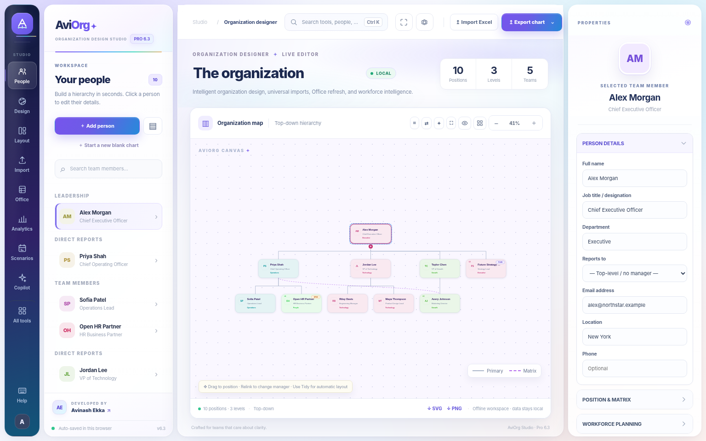
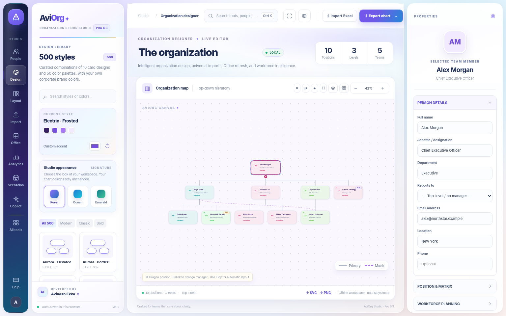
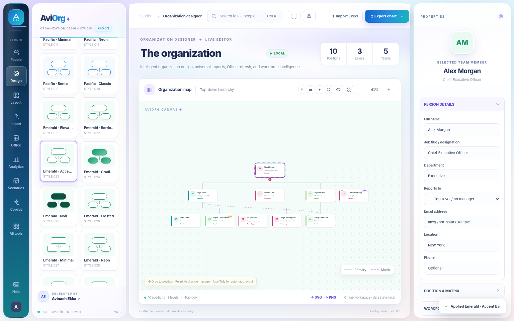
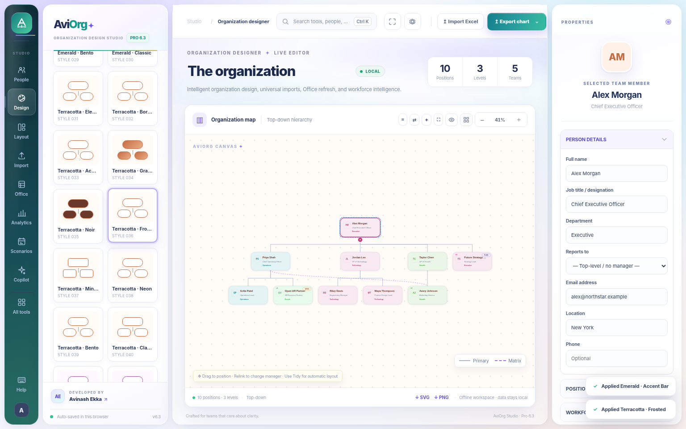
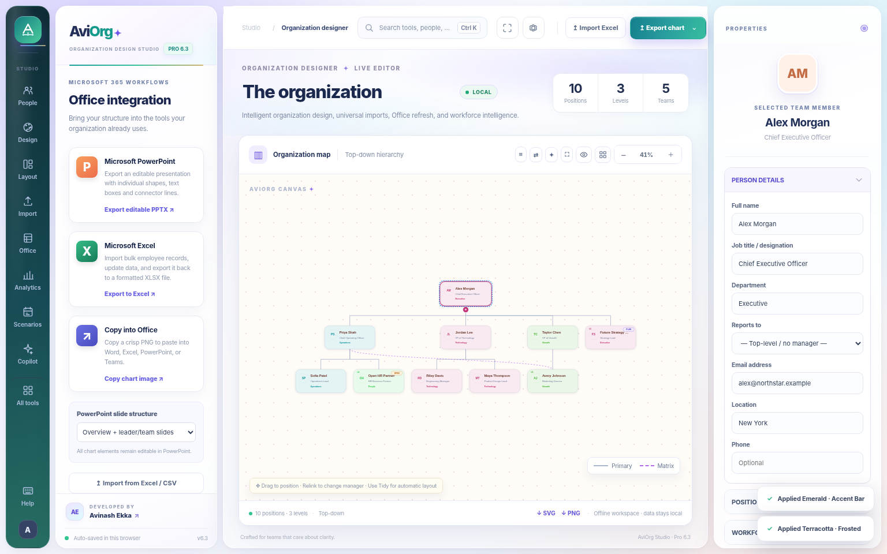

<div align="center">
  

  # AviOrg Studio

  ### Intelligent Organization Design, Beautifully Simplified

  **A premium, colorful organizational-chart studio for teams and businesses.**

  **AviOrg Pro 6.3 · Signature Luxe Edition**  
  **Developed by Avinash Ekka**

  [Explore Features](#features) · [Explore Screenshots](#screenshots) · [Get Started](#get-started) · [Excel & PowerPoint](#excel--powerpoint)
</div>

---

## Screenshots

### The signature workspace



### Design studio — 500 combinations



### Explore different looks

| Ocean Sapphire · Accent Bar | Emerald Luxe · Frosted |
| :---: | :---: |
|  |  |

### Office tools and advanced workflows

| Microsoft Office workflows | Workforce analytics |
| :---: | :---: |
|  |  |

*Screenshots are from the running AviOrg Studio application. Designs, colors, and chart layouts are customizable.*

## Features

| Module | Highlights |
| --- | --- |
| **Signature Luxe interface** | Royal, Ocean and Emerald workspace finishes, jewel-tone accents, layered panels, visual polish and improved contrast. |
| **Premium design studio** | 500 chart-style combinations, custom palettes, department colors, typography, and card styling. |
| **Visual org-chart editor** | Add, connect, move, align, zoom, focus and rearrange reporting cards and teams. |
| **Excel & CSV imports** | Bulk employee upload, smart column mapping, validation and review before data changes. |
| **Editable PowerPoint** | Export native PPTX text, cards and connector shapes for further editing. |
| **Workforce intelligence** | Explore positions, FTE, vacancies, management spans and annual position costs. |
| **Scenario planning** | Save snapshots, compare organizational structures and model changes. |
| **Matrix reporting** | Primary and dotted-line managers, configurable connector lines and spacing. |
| **Smart chart importer** | Reopen supported AviOrg/Structura project files; review estimated reconstructions from external PPTX/Visio/text PDFs. |
| **AI-assisted tools** | Supported local language commands, layout checks, change previews and optional user-configured local models. |
| **Multiple export formats** | PowerPoint, Excel, CSV, SVG, PNG, PDF and project JSON. |
| **Portable edition** | Run the standalone HTML locally in Chrome or Edge, with no backend needed for the core editor. |

## Get started

### Open the offline application

1. Open the [**AviOrg Studio standalone app**](standalone/AviOrg_Studio_Pro_6_3_Luxury.html) in the repository.
2. Download the HTML file and open it in **Google Chrome** or **Microsoft Edge**.
3. Start with the example organization, create your own team, or import an Excel workbook.
4. Use the **Design** panel to change chart templates, styling, and the workspace appearance.
5. Export the completed org chart in your preferred format.

### Run the website edition locally

If you have downloaded the repository, you can serve the website version with Python:

```bash
python -m http.server 8000
```

Then open <http://localhost:8000> in your browser. The same static website assets can also be hosted on GitHub Pages.

## Create your first org chart

1. **Create or import employees.** Add reporting cards manually, or upload your Excel/CSV file.
2. **Confirm manager relationships.** Review the primary hierarchy and add any dotted-line reporting relationships.
3. **Select a premium design.** Choose a layout, card style, palette or departmental color scheme.
4. **Fine-tune your canvas.** Adjust spacing, connectors, zoom and precise card positions.
5. **Analyze or plan.** Explore headcount summaries or compare alternate structures.
6. **Export and share.** Download editable PowerPoint slides, a PDF, a PNG/SVG image, or a data file.

## Excel & PowerPoint

**Excel import template:** [Download the sample XLSX](examples/AviOrg_Excel_Import_Template.xlsx) to populate employees, IDs, job titles, departments and managers. Preview validation results before applying updates.

**Editable PowerPoint example:** [Open the sample PPTX](examples/AviOrg_Editable_Example.pptx). AviOrg exports editable PowerPoint shapes rather than embedding only a flat screenshot.

## Designed for

HR professionals, managers, organizational designers, consultants, nonprofits, project teams and anyone producing high-quality reporting charts and leadership presentations.

## Privacy & compatibility

The core application processes your organization data in your browser. Browser storage can retain local projects; use JSON backups for important work and avoid shared devices when working with confidential employee records. **Never upload real employee datasets or secrets into a public repository.**

A public GitHub Pages website is not a secure employee directory. Microsoft 365 live synchronization, official Office add-ins, enterprise sign-on, real-time shared editing and hosted AI all require additional authorized services. External chart reconstruction may require manual correction.

Older AviOrg/Structura project data remains supported. The workspace appearance selector changes the application interface **without modifying chart records or existing chart designs**.

## Credits

**Developed by Avinash Ekka**  
*Exploring AI and technology to make everyday work easier, smarter and more efficient.*

Third-party library information is available in [Third-Party Notices](THIRD_PARTY_NOTICES.md). See [Licensing Information](docs/LICENSING.md) for the project's current license status.
